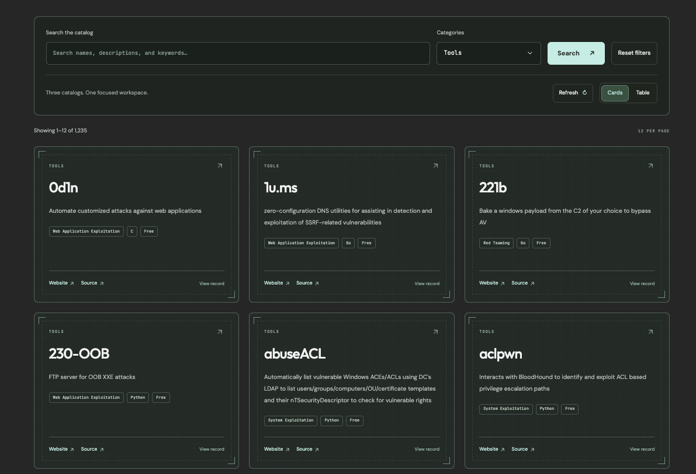

  

  <h1>ReconVault</h1>

  

    
  

  

    
    
    
    
    
  

  
Less Searching. More Discovering.

## Overview

**ReconVault** is a focused discovery workspace from CursedSec for security tools, capture-the-flag challenges, and professional certifications.

Instead of scattered bookmarks, endless search results, and disconnected resource lists, ReconVault brings curated discovery into one searchable catalog. Find the right tool, choose your next CTF, or plan the certification path that matches your goals.

> ReconVault is a discovery and reference workspace. It does not host exploit code, provide unauthorized access instructions, or replace independent verification of a tool, challenge, certification, or vendor.

## Explore the Vault

ReconVault organizes its catalog into three focused collections:

| Catalog | What it helps you find |
| :--- | :--- |
| Tools | Security tools, utilities, and resources for research, assessment, and operational workflows |
| CTFs | Capture-the-flag platforms, challenges, and learning opportunities |
| Certifications | Professional credentials, learning paths, and certification options |

The workspace is designed to reduce discovery friction: search first, compare the results, then explore the details that matter.

## Features

| Capability | What it does |
| :--- | :--- |
| Unified catalog | Brings tools, CTFs, and certifications into a single discovery workspace. |
| Keyword search | Searches entry names, descriptions, and keywords. |
| Category filtering | Filters results across Tools, CTFs, and Certifications. |
| Card and table views | Switches between visual cards and a structured table view. |
| Pagination | Presents catalog results in pages of 12 entries. |
| Entry details | Opens a focused record view with overview, metadata, collection, and added-date context. |
| External references | Provides links to the relevant resource or official source where available. |
| Refresh control | Reloads the catalog data from the workspace configuration. |
| Accessible interface | Includes skip navigation, semantic landmarks, live status regions, keyboard-friendly controls, and a no-JavaScript notice. |

## Screenshots:

### Interface

## Discovery Workflow

1. **Discover** — Search the catalog using a keyword, tool name, challenge type, or certification interest.
2. **Compare** — Filter by category and review the available entries.
3. **Explore** — Open an entry to inspect its overview, metadata, collection, and external references.

The goal is simple: spend less time hunting for resources and more time building capability.

## Website Experience

ReconVault is a browser-based discovery workspace, not a downloadable application.

| Area | Purpose |
| :--- | :--- |
| Hero workspace | Introduces the three catalogs and displays live record totals |
| Search panel | Provides keyword search, category selection, reset, refresh, and view switching |
| Results area | Displays catalog entries as cards or a table |
| Pagination | Helps navigate larger result sets |
| Record dialog | Presents detailed information for a selected catalog entry |
| Footer | Connects visitors to CursedSec services, projects, resources, and social channels |

## Technology

| Component | Purpose |
| :--- | :--- |
| HTML | Page structure, accessibility landmarks, dialogs, and content sections |
| CSS | CursedSec visual identity, responsive layout, panels, and interaction states |
| JavaScript | Catalog loading, search, filtering, pagination, view switching, and dialogs |
| JSON configuration | Catalog data and workspace configuration |
| Google Fonts | DM Sans, Outfit, and JetBrains Mono typography |

## Access ReconVault

ReconVault is available through its dedicated CursedSec website:

**https://reconvault.cursedsec.com/**

No installation, account creation, or local setup is required to explore the catalog.

## Using the Catalog

| Task | How to do it |
| :--- | :--- |
| Find a security tool | Select **Tools**, enter a keyword, and review the results |
| Find a CTF | Select **CTFs**, search for a challenge type or platform, and open an entry |
| Plan a certification | Select **Certifications**, compare available credentials, and review the entry details |
| Reset the workspace | Select **Reset filters** |
| Refresh catalog data | Select **Refresh** |
| Change result layout | Switch between **Cards** and **Table** |
| Open entry details | Select an entry to open its focused record dialog |

## Design Principles

- **Focused discovery:** Reduce noise and make relevant resources easier to find.
- **Practical utility:** Favor entries that support real learning, research, and operational workflows.
- **Clear context:** Present each entry with enough information to decide whether it is worth exploring.
- **Accessible interaction:** Use semantic structure, live status updates, keyboard navigation, and skip navigation.
- **CursedSec identity:** Maintain a dark, technical, and focused discovery experience.

## Known Limitations

- Catalog coverage depends on the entries maintained in the ReconVault configuration.
- Search results are only as current as the latest catalog refresh and underlying data.
- External resources may change, become unavailable, or alter their own terms of use.
- ReconVault does not independently validate every listed tool, challenge, certification, or vendor.
- JavaScript is required for catalog loading and interactive filtering.
- The site is intended as a discovery aid, not a comprehensive directory of every security resource.

## Safe Use

- Verify a tool or resource through its official source before downloading or using it.
- Review licensing, data-handling practices, and supported platforms before adopting a tool.
- Confirm certification requirements, pricing, and eligibility directly with the issuing organization.
- Use CTF platforms and security tools only within their applicable rules and authorized scope.
- Do not treat a catalog listing as an endorsement, guarantee, or complete security assessment.

## Roadmap Ideas

- Expand curated tool, CTF, and certification coverage.
- Add richer filtering and sorting options.
- Introduce saved searches or personal shortlists.
- Improve entry metadata and external-reference consistency.
- Add curated learning paths and resource collections.

## Feedback & Contributions

Use the repository's issue tracker for catalog corrections, broken links, feature suggestions, or accessibility feedback.

Include the affected entry or URL, expected behavior, observed behavior, browser information, and reproduction steps. Do not submit credentials, private program invitations, client information, or sensitive vulnerability details.

## Connect & Collaborate

  
  
  
  

  
Discover with purpose. Learn with intent. Build without the noise.

  CursedSec.com · Cursed271 · ReconVault

